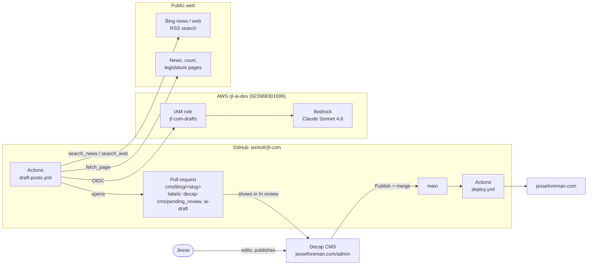
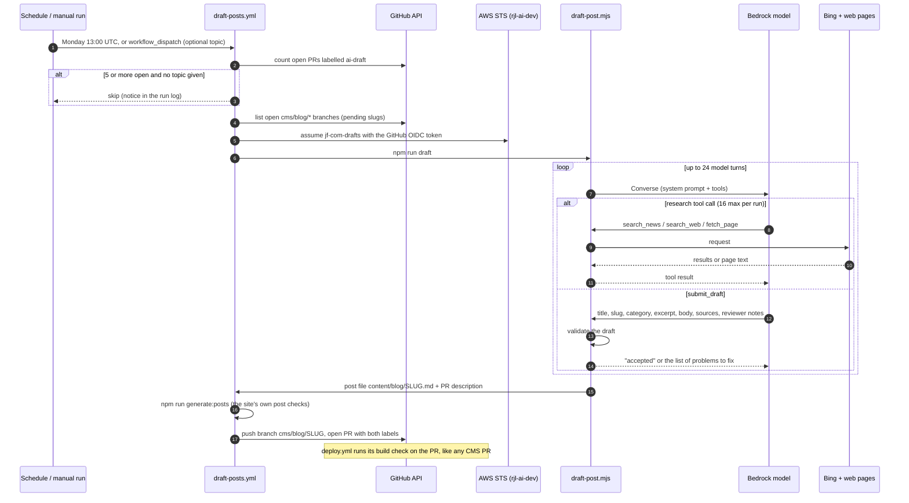
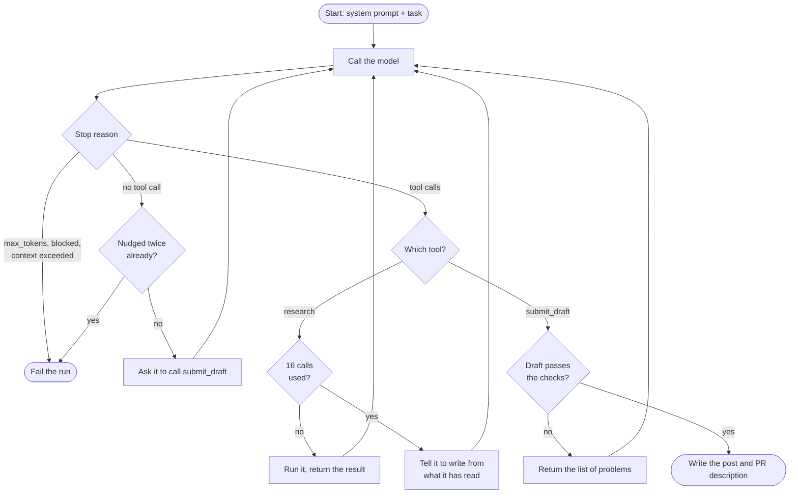
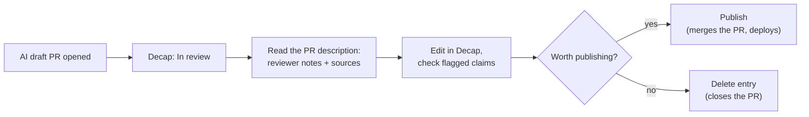
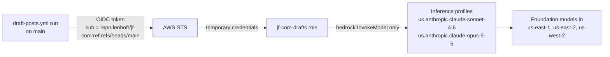

# AI blog drafts

Once a week a GitHub Action asks a model on Amazon Bedrock to research a current
story and draft a blog post in Jesse's voice. The draft lands in Decap's
**In review** column like any post an editor saved. Jesse edits it, then
publishes or deletes it. **Nothing the automation does can reach the live site**:
a post goes live only when Jesse (or anyone with write access) publishes it,
which merges the pull request.

Live since 2026-11-09 (PRs #60, #62, #64).

## Contents

- [The pieces](#the-pieces)
- [How a run works](#how-a-run-works)
- [Inside the drafting script](#inside-the-drafting-script)
- [Guardrails](#guardrails)
- [Reviewing a draft](#reviewing-a-draft)
- [Running it and changing it](#running-it-and-changing-it)
- [AWS access](#aws-access)
- [Cost](#cost)
- [Why it is built this way](#why-it-is-built-this-way)
- [Known limitations](#known-limitations)
- [Troubleshooting](#troubleshooting)
- [Possible next steps](#possible-next-steps)

## The pieces

| Path                                    | What it is                                                                                       |
| --------------------------------------- | ------------------------------------------------------------------------------------------------ |
| `.github/workflows/draft-posts.yml`     | The schedule, the queue check, AWS login, validation, and opening the pull request.              |
| `automation/draft-posts/draft-post.mjs` | The drafting script: prompt, research tools, model loop, draft checks, output files.             |
| `infra/ai-account/`                     | Terraform for the IAM role the workflow uses in the **rjl-ai-dev** AWS account. Applied by hand. |
| `frontend/scripts/generate-posts.mjs`   | The site's post validator. The workflow runs it on the draft before opening the PR.              |
| `frontend/public/admin/config.yml`      | Decap's config. `publish_mode: editorial_workflow` is what makes PRs show up as review entries.  |



## How a run works



What each step is for:

- **Queue check.** If 5 or more AI drafts are already waiting
  (`MAX_OPEN_DRAFTS` in the workflow), nobody is reading them, so the scheduled
  run skips instead of piling up more. A manual run with a topic always goes
  ahead.
- **Pending slugs.** Every open `cms/blog/*` branch (AI drafts and Jesse's own
  unpublished drafts) is passed to the script, so the model won't pick a topic
  already waiting for review. Closed or deleted drafts are not on that list, so
  their topic can come back.
- **Validation.** `generate-posts.mjs` is the same check the deploy build runs.
  Running it here means a malformed draft fails the workflow instead of landing
  in Jesse's queue with a red check.
- **The PR.** The branch name and labels are exactly what Decap creates for its
  own entries, which is all Decap needs to show it on the board. The PR is
  opened with a personal access token (`DRAFT_POSTS_TOKEN`) rather than the
  workflow's own token, because this repo doesn't let Actions open PRs, and
  PRs opened by the workflow token wouldn't trigger `deploy.yml`'s build check.

## Inside the drafting script

`draft-post.mjs` runs one conversation with the model through Bedrock's
**Converse API** (`@aws-sdk/client-bedrock-runtime`). Converse works the same
way across Bedrock models, so the model can be swapped with one variable.

### The prompt

The system prompt (`const system` in the script) has six parts:

1. **Who Jesse is** and that posts publish under his name after his review.
2. **Research tools** and the 16-call budget.
3. **Accuracy rules**, framed around Kentucky's lawyer-advertising rules:
   every factual claim must come from a page read in this run and be linked
   inline; no rules or cases from memory; no guarantees, "expert" or
   "specialist" claims, or testimonials; a not-legal-advice line where a reader
   might act on the post.
4. **Style**: match Jesse's published posts. Short paragraphs, question
   headings, a bolded opening answer, 700 to 1,100 words, Markdown only.
5. **Voice**: rules against writing that reads as machine-made (see
   [Guardrails](#guardrails)).
6. **Jesse's published posts**, sent whole as style samples (the newest three).

The first message gives the task: either the topic from a manual run, or "find
one development from the last two weeks" for athletes and families (NIL,
college sports), people injured in Northern Kentucky, or business owners. It
also lists every published post and pending draft, so topics aren't repeated.

### Research tools

Bedrock has no built-in web search, so the script provides its own:

| Tool           | What it does                                                                                                    |
| -------------- | --------------------------------------------------------------------------------------------------------------- |
| `search_news`  | Bing News RSS (`bing.com/news/search?format=rss`). Up to 10 headlines, URLs, dates, snippets. No API key.       |
| `search_web`   | Bing web RSS (`bing.com/search?format=rss`), for court, legislature, agency and NCAA pages.                     |
| `fetch_page`   | Fetches one URL and reduces it to text (headings, paragraphs, list items, quotes), capped at 15,000 characters. |
| `submit_draft` | Hands in the finished post. Not a research call.                                                                |

Bing's RSS output is unofficial. If Bing changes it, searches return nothing
and drafts will fail for lack of sources. Search snippets are not sources: only
pages read with `fetch_page` can be cited.

### The loop



All tool calls in one turn get their results back in a single message. The run
fails if there is no accepted draft after 24 turns.

On Anthropic models, the system prompt is marked with a Bedrock `cachePoint`,
so every turn after the first reads it from the prompt cache instead of paying
for it again. Other models don't accept that field, so it's left off for them.

### Output

- `content/blog/<slug>.md`, with the same frontmatter Decap writes (`title`,
  `slug`, `date`, `category`, `excerpt`, `draft: false`). No image: the site
  shows generated art until Jesse uploads one.
- The PR description: a warning that the draft is AI-generated and unchecked,
  the model's **notes for the reviewer** (claims to double-check, judgement
  calls, anything it couldn't confirm), the **source list**, and which model
  wrote it.
- The run log lists every search and fetch, any rejected submissions, and
  token usage.

## Guardrails

The model is asked to follow rules in the prompt, but the important ones are
also **checked in code**, because models don't reliably follow instructions
(every model tried overshot the word limit, for example). A draft that fails a
check goes back to the model with the specific problems, the same way an editor
would send it back.

| Check                  | Rule                                                                                                                                                                                                                           |
| ---------------------- | ------------------------------------------------------------------------------------------------------------------------------------------------------------------------------------------------------------------------------ |
| Fields                 | Title, slug, category, excerpt, body, sources and reviewer notes are all present.                                                                                                                                              |
| Slug                   | Lowercase and hyphens, not used by a published post or a pending draft.                                                                                                                                                        |
| Category               | One of `postCategories` in `frontend/src/data/site.ts`.                                                                                                                                                                        |
| No raw HTML            | The site doesn't render it.                                                                                                                                                                                                    |
| Length                 | 600 to 1,250 words (the prompt asks for 700 to 1,100, so there is some slack).                                                                                                                                                 |
| Sources are real       | Every link in the body and every listed source must be a page `fetch_page` read in this run. Tracking query strings (`?utm_…`) may be dropped.                                                                                 |
| Inline citations       | The body links at least one source.                                                                                                                                                                                            |
| No dashes              | No em dash (—) or en dash (–) in the title, excerpt or body.                                                                                                                                                                   |
| No obvious AI phrasing | None of: "it's not X, it's Y", "not just X, but Y", "here's what/why/how", "let's dive/unpack", "delve", "deep dive", "in today's…", "game-changer", "the bottom line", "key takeaways", "in conclusion", "it's worth noting". |

The dash and phrasing checks skip blockquotes, quoted speech and link URLs, so
quotes from sources stay word for word. Softer tells ("navigate", "landscape",
"crucial", "ultimately", three-item lists, a summing-up ending) are in the
prompt's Voice rules but are not enforced, because they have legitimate uses
("the court ultimately ruled").

After the script, the workflow runs the site's own validator
(`generate-posts.mjs`), and the PR then gets `deploy.yml`'s build check.

**What the checks can't catch.** They prove a link was read, not that the page
says what the post claims. They can't tell a primary source from an outlet
re-reporting it, or catch a confident generalisation with no citation. That is
what Jesse's review is for, and why the reviewer notes exist.

## Reviewing a draft



- **The notes are on GitHub, not in Decap.** Decap's editor shows the post only.
  The reviewer notes, sources and the AI warning are in the pull request
  description: `https://github.com/lenhofr/jf-com/pulls?q=label:ai-draft`.
  Read them before editing.
- **Check the flagged claims.** The model often reaches a story through an
  outlet re-reporting it (ESPN numbers via Yahoo, for example) because the
  original site blocked it. The notes say when that happened.
- **Check the date.** Drafts are written about fast-moving stories. Anything
  "pending" or "expected" may have changed before Jesse gets to it.
- **Add an image** if wanted; otherwise the post uses generated art.
- **Delete what isn't worth it.** Deleting a draft frees its queue slot. Its
  topic may come back in a later run, since only open drafts are excluded.

AI drafts don't carry the `<!-- GHOSTWRITTEN -->` flag described in
[`content/README.md`](../content/README.md#review-flags). The pull request is
the review gate instead: an unpublished draft never reaches `main`, so there is
nothing for the build to warn about.

## Running it and changing it

**Schedule.** Mondays at 13:00 UTC (8am Eastern in winter, 9am in summer).

**Run it now:**

```sh
gh workflow run draft-posts.yml --ref main                           # model picks the topic
gh workflow run draft-posts.yml --ref main -f topic="<what to write about>"
gh run watch                                                           # follow it
```

Or use **Actions → draft-posts → Run workflow** on GitHub. Runs share a
concurrency group, so a second run waits for the first. It then sees the first
draft as pending and picks a different topic. Only one run can wait at a time:
starting a third while one is waiting cancels the waiting one.

**Settings:**

| Setting                | Where                                                  | Now                                        |
| ---------------------- | ------------------------------------------------------ | ------------------------------------------ |
| Schedule               | `cron` in `draft-posts.yml`                            | Mondays 13:00 UTC                          |
| Open-draft limit       | `MAX_OPEN_DRAFTS` in `draft-posts.yml`                 | 5                                          |
| Model                  | Repository variable `DRAFT_MODEL_ID`                   | unset, so `us.anthropic.claude-sonnet-4-6` |
| Research budget, turns | `MAX_RESEARCH_CALLS`, `MAX_TURNS` in the script        | 16, 24                                     |
| Length                 | `MIN_WORDS`, `MAX_WORDS` in the script, and the prompt | 600 to 1,250 enforced; 700 to 1,100 asked  |
| Prompt, voice rules    | `const system` in the script                           |                                            |
| Enforced phrasing      | `AI_TELLS` in the script                               |                                            |
| Topic areas            | `const task` in the script                             | NIL/college sports, NKY injury, business   |

**Secrets** (repository settings):

| Secret                | What it is                                                                                                                                                                                      |
| --------------------- | ----------------------------------------------------------------------------------------------------------------------------------------------------------------------------------------------- |
| `AWS_DRAFTS_ROLE_ARN` | `arn:aws:iam::923988301699:role/jf-com-drafts` (`terraform output -raw drafts_role_arn` in `infra/ai-account`).                                                                                 |
| `DRAFT_POSTS_TOKEN`   | Fine-grained PAT on `lenhofr/jf-com` with Contents and Pull requests read/write. **It expires** (at most a year); when it does, runs fail at checkout. Create a new one and replace the secret. |

**Changing the model.** Add its inference profile to
`bedrock_inference_profiles` in `infra/ai-account`, apply, then set the
`DRAFT_MODEL_ID` repository variable. Opus 5.5
(`us.anthropic.claude-opus-5-5`) is already allowed by the role but blocked by
the Marketplace issue below. Non-Anthropic models work too, but see the
bake-off below before choosing one.

**Testing the script locally** (calls Bedrock for real and writes a file into
`content/blog/`; delete it afterwards):

```sh
cd automation/draft-posts
npm ci
AWS_PROFILE=<rjl-ai-dev profile> AWS_REGION=us-east-1 \
  DRAFT_TOPIC="<topic>" PR_BODY_PATH=/tmp/pr-body.md npm run draft
```

## AWS access

The model runs in the **rjl-ai-dev** account (923988301699), separate from the
site's own AWS account. The workflow logs in with GitHub's OIDC token, so no AWS
keys are stored anywhere.



- Only runs of this repo **on `main`** can assume the role. A branch or fork
  can't.
- The role can call the listed models and nothing else. It deliberately has no
  AWS Marketplace permissions, so a run can never subscribe the account to a
  new paid model.
- The Terraform is in [`infra/ai-account/`](../infra/ai-account/README.md),
  with state in `tf-state-923988301699-us-east-1` under
  `jf-com-drafts/terraform.tfstate`. It is applied by hand, because the site's
  CI has no access to that account.

## Cost

A run uses roughly 85,000 to 105,000 input tokens (about 80% of them read from
the prompt cache) and 5,000 to 9,000 output tokens. At Sonnet 4.6's on-demand
list prices that is roughly **$0.20 to $0.30 per draft**, or about $1 to $1.50
a month on the weekly schedule. The searches and page fetches are free. Check
the real figure in Cost Explorer for the rjl-ai-dev account (service: Bedrock).
There is no budget alert yet.

## Why it is built this way

**Bedrock instead of Claude Platform on AWS.** The plan was Claude Opus 5.5
through Claude Platform on AWS, which has built-in web search. Both signing up
for Claude Platform and using Opus 5.5 on Bedrock need a new AWS Marketplace
agreement. In this account, every new agreement fails with
`CreateAgreementRequest AccessDenied: "AWS account registration is incomplete
or revoked"`. An AWS support case was filed on 2026-11-09. Sonnet 4.6 works
because its agreement dates from April 2026. Bedrock has no web search, so the
script brings its own research tools.

**Model bake-off (2026-11-09),** same topic for each:

| Model                                 | Result                                                                                         |
| ------------------------------------- | ---------------------------------------------------------------------------------------------- |
| Claude Sonnet 4.6                     | Best voice, closest to Jesse's posts. **Chosen.**                                              |
| Kimi K3.1 (`us.moonshotai.kimi-k3.1`) | The most careful with facts, but stiff. A reasonable fallback. Needs no Marketplace agreement. |
| DeepSeek V3.2                         | Stated a transfer rule that doesn't exist and left out links. Rejected.                        |

**Pull requests instead of a separate approval system.** Decap already treats
`cms/*` pull requests as its review board, and merging is already the only way
to publish. An AI draft is just another entry on that board, so there is no
new place for Jesse to look and no way to skip review.

**Checks in code, not just in the prompt.** Prompt rules alone didn't hold
(every model overshot the length, and the first drafts had 12 to 17 em dashes
each), so the rules that matter are enforced and the model is made to fix its
own draft.

## Known limitations

- **About half of page fetches fail.** AP, Gannett papers (USA Today, Courier
  Journal), MSN, The Athletic and Courthouse News block automated reading or
  need JavaScript. The model then relies on outlets re-reporting the story, and
  says so in its notes.
- **Topics lean to NIL and college sports,** because that's where most of the
  current news is. Kentucky personal-injury and business topics haven't come
  up yet.
- **Unsourced generalisations** ("programs will…", "families should…") still
  appear. They aren't factual claims the link check can test.
- **Drafts run long,** usually 1,050 to 1,250 words, and the model misreports
  its own word count in its notes.
- **Reviewer notes are only on GitHub,** not in Decap (see
  [Reviewing a draft](#reviewing-a-draft)).
- **Bing RSS is unofficial** and could change without notice.
- **The PAT expires**, and drafting stops when it does.

## Troubleshooting

| Symptom                                                                | Likely cause and fix                                                                                                                                                          |
| ---------------------------------------------------------------------- | ----------------------------------------------------------------------------------------------------------------------------------------------------------------------------- |
| Run ends early with "AI drafts are already awaiting review; skipping." | 5 drafts are open. Publish or delete some in Decap, or run manually with a topic.                                                                                             |
| Fails at "Configure AWS credentials"                                   | `AWS_DRAFTS_ROLE_ARN` is wrong, the run isn't on `main`, or the role was changed. Check `infra/ai-account`.                                                                   |
| `AccessDeniedException` from Bedrock                                   | The model in `DRAFT_MODEL_ID` isn't in `bedrock_inference_profiles`, or the account has no Marketplace subscription for it (`aws bedrock get-foundation-model-availability`). |
| Fails at checkout or the first `gh` command (`401`/`403`)              | `DRAFT_POSTS_TOKEN` has expired or lost a permission. Replace it.                                                                                                             |
| "no valid draft after 24 turns" or "stopped without submitting"        | The model kept failing a check. The log's `Draft rejected:` lines say which one. Run it again, or loosen the check if it's too strict.                                        |
| Every search returns "No results"                                      | Bing changed or blocked its RSS. `bingRss()` in the script needs a new search source.                                                                                         |
| Fails at "Validate against the site's post schema"                     | The draft broke a rule in `generate-posts.mjs` that the script doesn't check. Add that check to `validateDraft`.                                                              |

## Possible next steps

- Request Jesse's review on each draft PR, so the reviewer notes reach him by
  email.
- Switch to Opus 5.5 (`DRAFT_MODEL_ID`) once the AWS Marketplace case is resolved.
- A reader-service fallback for pages that block plain fetching.
- A Bedrock budget alert in the rjl-ai-dev account.
- A reminder before `DRAFT_POSTS_TOKEN` expires.
- Allow links to Jesse's own published posts (today they are rejected unless fetched).
