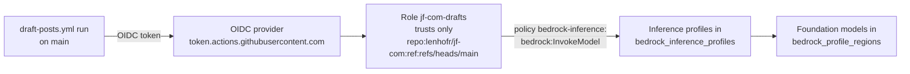

# infra/ai-account

IAM in the **rjl-ai-dev** AWS account (923988301699) that lets
`.github/workflows/draft-posts.yml` call models on Amazon Bedrock:

- the GitHub Actions OIDC provider for the account
- `jf-com-drafts`, a role only `lenhofr/jf-com` runs on `main` can assume,
  allowed only `bedrock:InvokeModel` on the inference profiles in
  `bedrock_inference_profiles` (and the models behind them)

The jf-com site infrastructure lives in a different account (`infra/terraform`),
and its CI can't reach this one, so this root is applied by hand. How the
drafting pipeline works as a whole is in
[`docs/ai-draft-posts.md`](../../docs/ai-draft-posts.md).



State: bucket `tf-state-923988301699-us-east-1`, key
`jf-com-drafts/terraform.tfstate`.

## Model subscriptions

Anthropic and other third-party models on Bedrock are sold through AWS
Marketplace, and the account needs an active subscription to each one. The role
deliberately has no Marketplace permissions, so it can only use models the
account is already subscribed to. Check a model with:

```sh
aws bedrock get-foundation-model-availability --region us-east-1 \
  --model-id anthropic.claude-sonnet-4-6
```

`agreementAvailability.status` must be `AVAILABLE`. As of 2026-11-09 that is
true for Claude Sonnet 4.6 but not for Claude Opus 5.5: new Marketplace
agreements for this account fail with "AWS account registration is incomplete
or revoked" (AWS support case open). Open-weight models that AWS sells directly
(DeepSeek, Kimi, Mistral, Llama, Amazon Nova) need no subscription.

## First-time setup

1. Apply with rjl-ai-dev credentials:

   ```sh
   cd infra/ai-account
   AWS_PROFILE=<rjl-ai-dev profile> terraform init
   AWS_PROFILE=<rjl-ai-dev profile> terraform apply
   ```

   The provider is pinned to account 923988301699, so the wrong profile fails at
   plan rather than creating anything elsewhere. If the account already has a
   GitHub OIDC provider, apply with `-var create_github_oidc_provider=false`
   (and set that as the default).

2. On `lenhofr/jf-com`, add:
   - secret `AWS_DRAFTS_ROLE_ARN`: `terraform output -raw drafts_role_arn`
   - secret `DRAFT_POSTS_TOKEN`: see the header of `draft-posts.yml`
   - optionally, variable `DRAFT_MODEL_ID` to use a model other than
     `us.anthropic.claude-sonnet-4-6`

## Changing models

Add the inference profile to `bedrock_inference_profiles`, apply, then set the
`DRAFT_MODEL_ID` repository variable. List profiles with
`aws bedrock list-inference-profiles --region us-east-1`; if a new profile routes
to regions outside `bedrock_profile_regions`, add them too.
