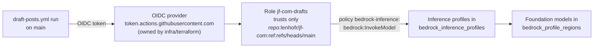

# infra/drafts-bedrock

IAM in AWS account **217354297026** (the same account as the site
infrastructure) that lets `.github/workflows/draft-posts.yml` call models on
Amazon Bedrock:

- `jf-com-drafts`, a role only `lenhofr/jf-com` runs on `main` can assume,
  allowed only `bedrock:InvokeModel` on the inference profiles in
  `bedrock_inference_profiles` (and the models behind them)
- `jf-com-drafts`, an application inference profile tagged
  `app = jf-com-drafts` that copies `drafts_profile_source` (Sonnet 4.6), so
  the drafts' Bedrock spend can be filtered by tag in Cost Explorer. Activate
  `app` as a cost allocation tag in Billing for it to show up.

The role trusts the account's existing GitHub OIDC provider, which
`infra/terraform` (the site root) creates and owns; this root only looks it up.
It is a separate root so the site's deploy pipeline never plans or applies it,
and it is applied by hand. How the drafting pipeline works as a whole is in
[`docs/ai-draft-posts.md`](../../docs/ai-draft-posts.md).



State: bucket `tf-state-common-217354297026-us-east-1`, key
`jf-com-drafts/terraform.tfstate`.

Until 2026-11 this root was `infra/ai-account` and targeted the separate
rjl-ai-dev account (923988301699), where AWS zeroed every Bedrock quota during
an account-verification hold. The role and OIDC provider it created there (state
in `tf-state-923988301699-us-east-1`, same key) are left in place until that
support case closes, then destroyed by hand.

## Model subscriptions

Anthropic and other third-party models on Bedrock are sold through AWS
Marketplace, and the account needs an active subscription to each one. The role
deliberately has no Marketplace permissions, so it can only use models the
account is already subscribed to. Check a model with:

```sh
aws bedrock get-foundation-model-availability --region us-east-1 \
  --model-id anthropic.claude-sonnet-4-6
```

`agreementAvailability.status` must be `AVAILABLE`. As of 2026-11-20 a test
call to Claude Sonnet 4.6 from an admin session in this account succeeded, but
this check still reports `NOT_AVAILABLE` for both Sonnet 4.6 and Opus 5.5.
Opus 5.5 also has a tokens-per-minute quota of 0 here, so it can't be used
until that is raised. Open-weight models that AWS sells directly
(DeepSeek, Kimi, Mistral, Llama, Amazon Nova) need no subscription.

## First-time setup

1. Apply with credentials for 217354297026:

   ```sh
   cd infra/drafts-bedrock
   AWS_PROFILE=<217354297026 profile> terraform init
   AWS_PROFILE=<217354297026 profile> terraform apply
   ```

   The provider is pinned to account 217354297026, so the wrong profile fails at
   plan rather than creating anything elsewhere. `infra/terraform` must be
   applied first, since it creates the OIDC provider this role trusts.

2. On `lenhofr/jf-com`, add:
   - secret `AWS_DRAFTS_ROLE_ARN`: `terraform output -raw drafts_role_arn`
   - variable `DRAFT_INFERENCE_PROFILE_ARN`:
     `terraform output -raw drafts_inference_profile_arn`
   - secret `DRAFT_POSTS_TOKEN`: see the header of `draft-posts.yml`
   - optionally, variable `DRAFT_MODEL_ID` to use a model other than
     `us.anthropic.claude-sonnet-4-6`

## Changing models

Add the inference profile to `bedrock_inference_profiles` and set
`drafts_profile_source` to it, apply, then set the `DRAFT_MODEL_ID` repository
variable to the profile ID and `DRAFT_INFERENCE_PROFILE_ARN` to the new
`drafts_inference_profile_arn` (changing the source replaces the application
profile, so the ARN changes). List profiles with
`aws bedrock list-inference-profiles --region us-east-1`; if a new profile routes
to regions outside `bedrock_profile_regions`, add them too.

## Quotas

Sonnet 4.6's on-demand quota in this account is 10 requests a minute (6M
tokens a minute, far above a run's ~100k total). A run
makes up to 24 Converse calls back to back, so `draft-post.mjs` retries
`ThrottlingException` with waits of 10 to 60 seconds. If runs keep spending
minutes in those waits, request an increase in Service Quotas (Amazon Bedrock,
"cross-Region model inference requests per minute" for the model).
